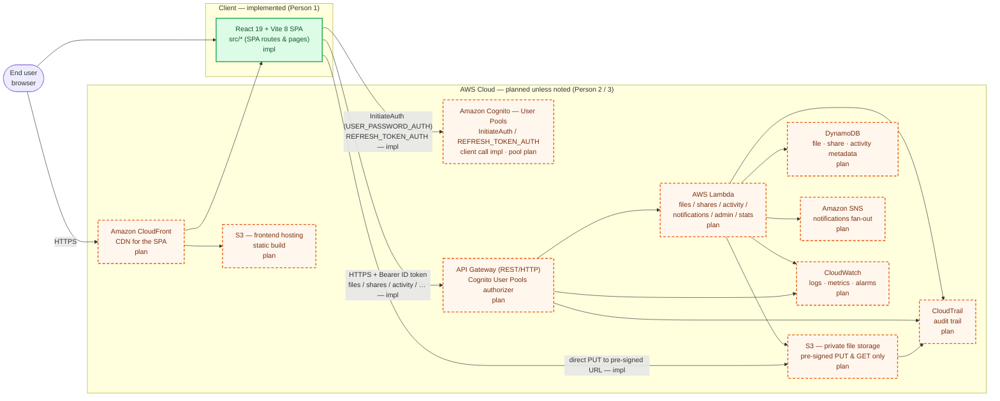

# SecureVault — Architecture

This document shows the SecureVault architecture and clearly separates what is **already
implemented** (Person 1's frontend, plus the client-side integration code) from what is
**planned** for Persons 2 and 3. Nothing here creates or modifies AWS resources.

## Legend

| Style | Meaning |
| --- | --- |
| 🟢 Solid green, `impl` | Implemented in this repository (React/Vite frontend + its client-side integration code) |
| 🟠 Dashed orange, `plan` | Planned / not yet provisioned or implemented |
| Arrows | Data / control flow. Arrow labels note whether the **client call** is already implemented |

> The frontend's **client-side** calls to Cognito, the API Gateway endpoint and the S3
> pre-signed URL are implemented. The corresponding **AWS resources** and backend handlers are
> planned. That is why the same node can be "implemented" from the app's point of view but
> still `plan` as infrastructure.

---

## 1. Target architecture (implemented vs. planned)



> **Mermaid note:** if your Markdown viewer does not render Mermaid, the same diagram is
> reproduced as ASCII in §2 below.

---

## 2. ASCII fallback

```
                         ┌──────────────────────────────────────────────┐
                         │                End user (browser)             │
                         └───────────────┬──────────────────────────────┘
                                         │ HTTPS
                                         ▼
                    ┌────────────────────────────────────────┐
                    │   React 19 + Vite 8 SPA  (IMPLEMENTED)   │
                    │   src/* — Login, Overview, My Files,     │
                    │   Shared with Me, Activity, Admin,       │
                    │   Settings + api.js / authService.js     │
                    └───┬───────────────┬───────────────┬──────┘
     InitiateAuth /     │               │ Bearer ID     │ direct PUT to
     REFRESH_TOKEN_AUTH │               │ token (HTTPS) │ pre-signed URL
     (client IMPL)      │               │ (client IMPL) │ (client IMPL)
                        ▼               ▼               ▼
          ┌──────────────────┐  ┌───────────────┐  ┌──────────────────┐
          │ Amazon Cognito   │  │  API Gateway  │  │  S3 — PRIVATE    │
          │ User Pools       │  │  + Cognito    │  │  FILE STORAGE    │
          │ (PLANNED pool)   │  │  authorizer   │  │  (PLANNED)       │
          └──────────────────┘  │  (PLANNED)    │  └──────────────────┘
                                └───────┬───────┘           ▲
                                        ▼                    │
                                ┌───────────────┐            │
                                │     Lambda    │────────────┘
                                │   (PLANNED)   │
                                └───┬───┬───┬───┘
                                    │   │   │
                        ┌───────────┘   │   └───────────┐
                        ▼               ▼               ▼
                 ┌────────────┐  ┌────────────┐  ┌────────────┐
                 │ DynamoDB   │  │ Amazon SNS │  │CloudWatch  │
                 │ (PLANNED)  │  │ (PLANNED)  │  │ (PLANNED)  │
                 └────────────┘  └────────────┘  └────────────┘

                 ┌────────────┐   ┌────────────────────────────┐
                 │CloudTrail  │   │ CloudFront → S3 frontend   │
                 │ (PLANNED)  │   │ hosting  (PLANNED)         │
                 └────────────┘   └────────────────────────────┘
```

---

## 3. What is implemented today (Person 1)

| Component | Status | Where |
| --- | --- | --- |
| React + Vite SPA, routing, layout, all pages | ✅ Implemented | `src/App.jsx`, `src/pages/*`, `src/components/*` |
| Cognito client integration (`InitiateAuth`, `REFRESH_TOKEN_AUTH`, token refresh, session in `sessionStorage`) | ✅ Implemented (client) | `src/services/authService.js`, `src/context/AuthContext.jsx` |
| Bearer-token API client + typed errors + `501` handling | ✅ Implemented | `src/services/apiClient.js`, `src/errors.js` |
| API calls for files, shares, activity, notifications, stats, admin | ✅ Implemented (client) | `src/services/api.js` |
| Pre-signed upload flow (request URL → direct S3 `PUT` → reload) | ✅ Implemented (client) | `src/services/api.js`, `src/pages/MyFilesPage.jsx` |
| "Not connected" / "integration pending" states (never mock data) | ✅ Implemented | `src/components/StateViews.jsx`, `src/errors.js`, `src/config.js` |

## 4. What is planned (Persons 2 & 3)

| Component | Owner | Notes |
| --- | --- | --- |
| Cognito User Pool + public app client (`ALLOW_USER_PASSWORD_AUTH`, `ALLOW_REFRESH_TOKEN_AUTH`) | Person 3 | Region, pool id, client id → `VITE_*` |
| API Gateway with Cognito User Pools authorizer | Person 2/3 | Base URL → `VITE_API_BASE_URL` |
| Lambda handlers for `/files`, `/files/upload-url`, `/files/{id}/download`, `DELETE /files/{id}`, `/shares`, `/activity`, `/notifications`, `/stats`, `/admin/*` | Person 2 | See `API_INTEGRATION.md` |
| Private S3 bucket for file bytes + CORS `PUT` from the frontend origin | Person 3 | Pre-signed PUT/GET only |
| DynamoDB tables for file/share/activity metadata | Person 2/3 | Enforced server-side authorization |
| Amazon SNS for notification fan-out | Person 3 | Backs `GET /notifications` |
| CloudWatch logs/metrics/alarms | Person 3 | Observability |
| CloudTrail audit trail | Person 3 | Backs audit activity |
| S3 static hosting + CloudFront for the SPA build | Person 3 | Later deployment stage |

---

## 5. End-to-end request flows

### 5.1 Sign-in (client implemented)
`Browser → Cognito InitiateAuth (USER_PASSWORD_AUTH) → ID/access/refresh tokens →
sessionStorage → Bearer ID token attached to every API call → silent REFRESH_TOKEN_AUTH before expiry.`

### 5.2 Upload (client implemented, backend planned)
`POST {API}/files/upload-url → Lambda creates metadata (DynamoDB) and signs an S3 PUT →
Browser PUTs bytes directly to S3 (CORS) → GET /files reloads the list.`

### 5.3 Download (client implemented, backend planned)
`GET {API}/files/{id}/download → Lambda authorizes and signs an S3 GET → browser downloads
from the pre-signed URL. The bucket is never made public.`

### 5.4 Share / revoke (client implemented, backend planned)
`POST /shares { fileId, recipient, permission, expiresAt } → share record in DynamoDB →
recipient sees it via GET /shares/received → DELETE /shares/{id} revokes it.`

### 5.5 Notifications (client implemented, backend planned)
`Lambda publishes to SNS on events → notification records surfaced via GET /notifications →
rendered in the TopBar bell menu.`

See `API_INTEGRATION.md` for the exact endpoint contracts and the agreed-vs-unconfirmed split.
